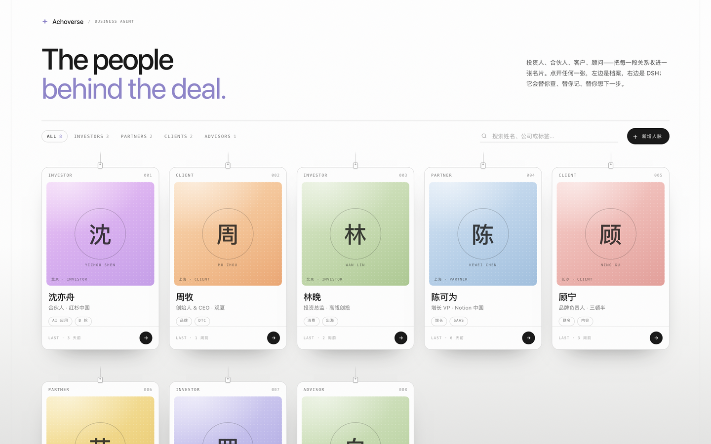
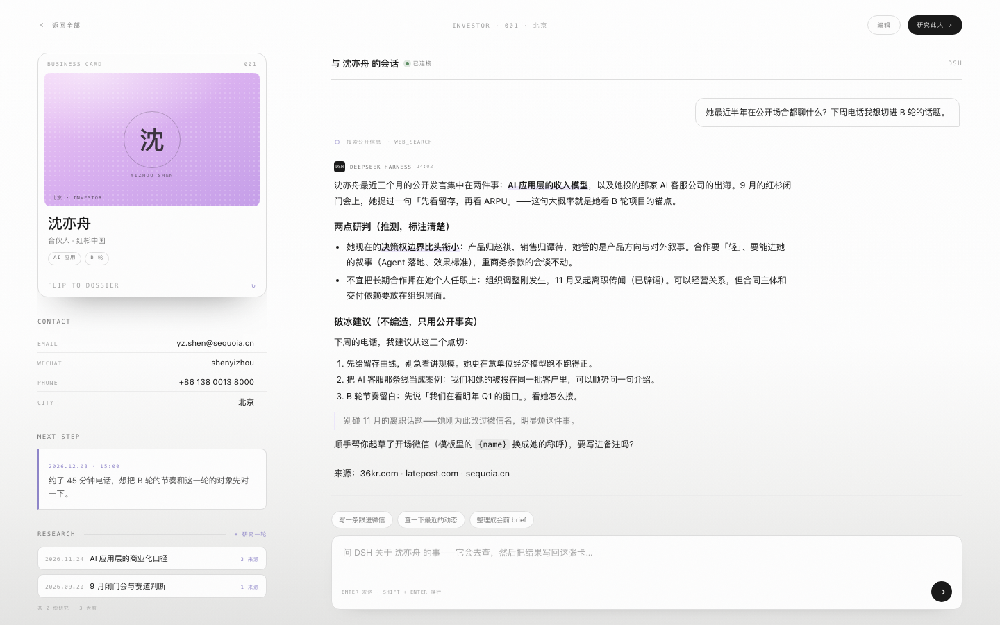

# 人脉助手（dsh-business-agent）

挂在 DeepSeek Harness 左侧边栏的私人商业人脉工作台：一个联系人一张名片，点开是「左边档案 / 右边 DSH 会话」。它替你查资料、记互动、写研究、想下一步。

[](https://www.npmjs.com/package/dsh-business-agent)
[](LICENSE)
[](https://www.npmjs.com/package/dsh-business-agent)



## 功能

- **名片墙**：分类可自定义（增删改名，默认投资人 / 合作伙伴 / 客户 / 顾问 / 其他），搜索、筛选、悬挂名片；左上角 `Achoverse / Business Agent` 品牌字标。
- **一句话新建**：把「周牧，观夏创始人，客户，标签 品牌 / DTC」交给 DSH，自动整理成名片；信息不够时在同一个输入框里反问。想手动填就点「改用表单」。
- **详情**：ID 卡可翻面成 DOSSIER，联系方式、下一步、互动时间线；右栏就是一个真实的 DSH 会话。
- **会话**：每个联系人绑定一个真实的 DSH 会话，共享 DSH 的搜索、工具权限、模型设置与历史；首次发消息才创建。会话有三层兜底（见「数据与隐私」）。
- **研究文档**：点 `研究此人 ↗`，DSH 真的联网检索；每轮结果存成一份**带日期与来源的 Markdown 文档**（一句话结论 / 事实 / 判断 / 下一步），左栏按时间列出，点开弹窗读全文与来源。
- **我的名片**：右上角入口，记「我是谁、今年目标、现在缺什么、能给别人什么、沟通忌讳」。打开就是一段会话，DSH 一次问一个问题，没答的问题挂在会话底部；想精确改也能点「编辑我的名片」用表单。
- **Agent 工具**：主会话里也能说「把沈亦舟加进人脉」「记一笔上周的电话」，或用工具查人、补下一步。
- **数据**：只写本机 `$DSH_HOME/business-cards/`，插件不做遥测或云同步。

## 详情页

左边是档案（卡可翻面、联系方式、下一步、研究文档、时间线），右边是绑定到这张卡的 DSH 会话：



## 安装

已发布到 npm：**[`dsh-business-agent`](https://www.npmjs.com/package/dsh-business-agent)**。版本约束：DSH `>=0.2.1-rc.5 <0.3.0`，Node 20+。

1. 左侧栏「插件」→「添加插件」→「安装第三方插件」。
2. 「包名或地址」填 `dsh-business-agent`；本地开发就填本目录的绝对路径。
3. 安装完成后按提示重启 DSH。
4. 侧栏出现「人脉助手」，点开即可。

- **更新**：本地目录改完重启 DSH 即可；从 npm 装则更新到新版本。
- **停用 / 卸载 / 回滚**：都走插件面板，不要手改 profile 的 `package.json` / `cordis.patch.yml`。

## 使用

1. 第一次打开会自动进「我的名片」：DSH 在会话里一个问题一个问题地问你；没答的问题在会话底部列着，点一下直接说答案就行。
2. 点 `+ 新增人脉`，用一句话描述这个人（例如「周牧，观夏创始人，客户，标签 品牌 / DTC」），DSH 会把它整理成名片并自动打开。
3. 回到墙上点卡片进详情；点左侧 ID 卡翻到 DOSSIER 背面。
4. 右栏直接提问，例如「她最近半年在关注什么？」「帮我写一条跟进微信」。
5. 点 `研究此人 ↗` 触发一轮联网研究；结果成为左栏 RESEARCH 里的一份文档，点开可看全文与来源。
6. 左侧 TIMELINE 点 `+ 记一条`，补一次微信 / 电话 / 线下 / 邮件 / 备注。
7. 墙上页签旁边的 `+ 分类` 可以增删改分类；删除分类时，该分类下的名片会并入「其他」。

### 在普通对话里使用

主 DSH 会话里可以直接说：

- 「把周牧加进人脉，观夏创始人，标注品牌 / DTC」
- 「沈亦舟最近在投什么？查完写回她的卡」
- 「帮我看看林晚的档案，准备明天见面」
- 「我今年在融种子轮、想找社区合伙人，帮我记进我的档案」

对应工具：

| 工具 | 作用 |
|---|---|
| `business_contact_list` | 按姓名 / 公司 / 标签找人，并返回当前分类 |
| `business_contact_get` | 读完整档案 |
| `business_contact_save` | 新建或部分更新（分类只能用已配置的 id） |
| `business_contact_note` | 追加一条互动 |
| `business_contact_research` | 在该联系人的会话里发起研究 |
| `business_contact_research_save` | 追加一份研究文档（Markdown + 来源 + 日期） |
| `business_me_get` | 读「我」的档案（给建议前先读） |
| `business_me_save` | 部分更新「我」的档案（身份 / 目标 / 需求 / 能给 / 偏好） |

## 数据与隐私

- 档案：`$DSH_HOME/business-cards/contacts.json`（原子写，保留最近 3 份备份）。
- 我的档案：`$DSH_HOME/business-cards/me.json`（原子写 + 备份；坏文件先备份再降级为空）。
- 分类：`$DSH_HOME/business-cards/types.json`（默认五类；`其他` 是兜底分类，不可删）。
- 会话缓存：`$DSH_HOME/business-cards/chats/<id>.json`（每张卡最多 2000 条，写成功后留一份 `.bak`；删除联系人时一并删除）。
- **会话不会丢**：缓存丢了会从 DSH 会话回读最近 120 条；DSH 会话失效时自动重建并保留面板历史；插件升级 / 重装不会清数据目录。
- 头像：本版只用姓氏字符章，未实现照片上传。
- 发消息 / 研究时，档案摘要会随提示词发给你配置的模型；研究时姓名、公司会发给搜索服务。插件本身不做遥测或云同步。
- 「我的名片」可一键清空；清空后提示词里不再出现你的个人信息。

## 开发

```sh
cd dsh-business-agent
npm install --cache ./.npm-cache   # esbuild + 仅预览用的 react/react-dom
npm run build                      # 产出 dist/client.js（__ModuleLoader__ 格式）
npm test                           # 存储 / Host 集成 / 客户端 bundle / 提示词 / Markdown
npm run preview                    # 真实组件 + 假后端，生成 test/preview/index.html
```

改完代码后：**只改了 `client/` 就用 `⌘R` / `Ctrl+R` 刷新界面**（打包版 DSH 的桌面菜单里没有 reload 项，这个快捷键是插件在客户端补的，只拦 ⌘/Ctrl+R，其它按键不动）；**动了 `src/` 必须重启 DSH**（Host 在应用进程里）。

预览页 URL 参数：`?open=c_shen` 打开详情、`&flip` 翻卡、`?theme=dark` 暗色、`?editor` 打开新增、`&research` 触发研究、`?me` 打开我的名片、`?noprofile` 看首次引导、`?types` 打开分类管理、`&send` 自动发一条消息。

## 文件

```
src/host.js        路由 + 会话接线 + 8 个工具 + 系统提示
src/store.js       contacts.json / me.json / types.json / chats 读写、校验、备份
src/prompt.js      档案上下文、我的档案压缩、研究与建档指令
client/            UI（app / wall / person / chat / research / me / types / markdown / editor / compose / ui / icons / i18n / api / styles）
scripts/           build.mjs（esbuild）、preview.mjs（真实组件 + 假后端）
test/              store / host / chat-recovery / me-host / prompt / markdown / research-format / preview
docs/screenshots/  README 用的界面截图
```

## 更新记录

最新版本的新增内容摘要（完整历史见 [CHANGELOG.md](CHANGELOG.md)）：

- **Unreleased**：自定义分类、研究记录 Markdown 结构化、会话三层兜底、我的名片恢复表单编辑、区块按钮改胶囊、JSON 报错人话提示。
- **0.4.0**：我的名片改为会话式提问；会话 Markdown 渲染（含表格）；隐藏原生滚动条；插件补 `⌘R` 刷新。
- **0.3.x**：包改名 `dsh-business-agent`（旧包已 deprecate）；README 截图与链接整理。

发版规则：**每次改动都要在 `CHANGELOG.md` 补一条**（开发期放 `[Unreleased]`，发版时改成版本号 + 日期），README 这段摘要同步更新。

## 仓库与许可

- 源码：<https://github.com/shlan28/dsh-business-agent>
- 问题：<https://github.com/shlan28/dsh-business-agent/issues>
- 许可：**MIT** —— 见仓库根目录 [LICENSE](LICENSE)，`package.json` 的 `license` 字段同为 `MIT`。
